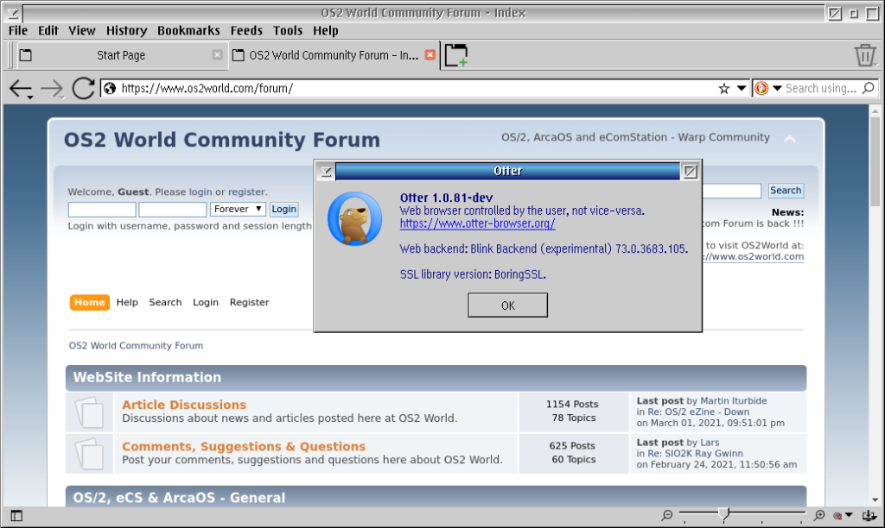
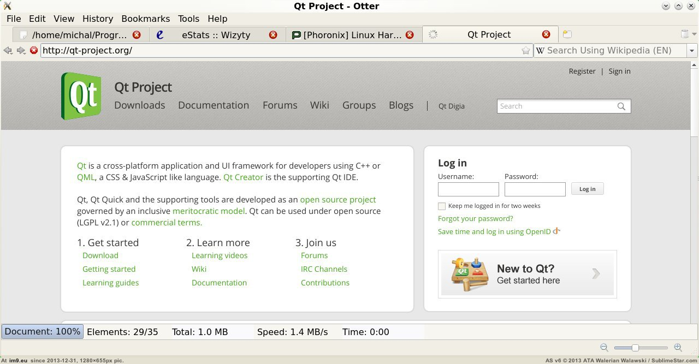

# Otter Browser Classic Interface and Flexible Browsing

Otter Browser is a desktop web browser inspired by the interface of Opera 12.
It combines a configurable Qt interface with browser tools for managing everyday navigation.

[](https://github.com/otter-web-browser/otter-browser/releases/)

## About Otter Browser

The Otter web browser focuses on restoring useful parts of a traditional desktop browsing workspace.
Menus, panels, tabs, and configurable actions provide several ways to reach common controls.

The project is developed as free software.
Its interface and rendering backend are separate parts of the application.

### Workspace Features

- Organize open pages through tabs and windows.
- Keep groups of pages in named sessions.
- Use keyboard shortcuts and mouse gestures.
- Access bookmarks, history, and other tools through panels.
- Configure content filtering.
- Manage browser data through the available settings.

## Browsing Tools

| Tool | Purpose | Practical distinction |
| --- | --- | --- |
| Tabs and windows | Separate open pages | Window layout and session state serve different roles |
| Named sessions | Return to a group of pages | A session is not an independent browser profile |
| Profile directory | Store browser user data | A separate directory keeps that profile's data together |
| Cache directory | Store cached browsing data | Can be selected independently of the profile |
| Private session | Start a private browsing context | Does not provide network anonymity |
| Content filtering | Apply configured blocking rules | Results depend on the rules and rendering backend |
| Keyboard and mouse actions | Reach browser commands | Available actions depend on the configured bindings |



## Classic Interface

The Otter Browser classic Opera UI goal concerns familiar interaction patterns.
It does not mean that the application contains the original Opera rendering engine.

Choose panels and controls that support the task at hand.
A smaller visible workspace can be useful when reading, while additional panels can help with research.

### A Research Session

1. Open the pages needed for a particular topic.
2. Keep unrelated browsing in a different window or session.
3. Save useful references as bookmarks.
4. Save the working set as a named session.
5. Return to the saved session when continuing the task.

Sessions preserve a browsing workspace.
They should not be treated as backups of account credentials or every item in a profile.

## Profiles and Session Controls

Otter Browser provides command-line controls for profile paths and session selection.
The examples below assume the executable is available as `otter-browser`.

```bash
otter-browser --profile="$HOME/otter-review" --cache="$HOME/otter-review-cache"
otter-browser --session-chooser
otter-browser --private-session
```

Each line is a separate launch example.
The first chooses explicit data locations, the second opens the session chooser, and the third requests a private session.

### Profile Boundaries

Use a separate profile when testing settings that should not affect a regular browsing workspace.
Keep the profile directory and cache directory identifiable.

- Close the relevant browser instance before making an external profile backup.
- Keep backups separate from the working directory.
- Check which profile is active before changing its settings.
- Avoid assuming that a named session creates a new profile.

## Portable Operation

The documented portable mode stores profile and cache directories beside the application binary.
It requires a location where the application can write its data.

The project documents an `arguments.txt` file beside the executable.
Its portable-mode content is:

```text
--portable
```

This file supplies a startup argument to Otter Browser.
It is not a Python configuration file or a browser extension.

### Moving a Portable Copy

Keep the executable and its associated data directories together.
Check that the destination supports the application and its runtime dependencies.

Portable mode changes where browser data is stored.
It does not make a binary compatible with a different operating system or processor.

## Content Filtering and Site Behavior

Content blocking is one of the browser's configurable tools.
Review the active filtering rules when a page behaves differently from expectations.

A useful troubleshooting sequence is to reproduce the issue, check the active rules, and compare with a separate test profile.
Record the selected rendering backend along with the result.

Browser features can differ between QtWebEngine and QtWebKit builds.
Check the capabilities of the package actually in use.



## Rendering Backends

Otter Browser Qt development separates the user interface from web rendering.
The stable source supports build options for QtWebEngine and QtWebKit.

These backends have different dependencies and compatibility characteristics.
A feature present in one backend may be incomplete or behave differently in another.

### Stable Source Requirements

The following requirements describe the v1.0.03 source configuration.
Development branches may require newer tools and libraries.

| Component | Stable source requirement | Role |
| --- | --- | --- |
| CMake | 3.1.0 or newer | Build configuration |
| C++ compiler | C++11 support | Application compilation |
| Qt | Qt 5.6.0 or newer with the required modules | Interface and platform services |
| QtWebEngine | Qt 5.9 or newer when enabled | Web rendering backend |
| QtWebKit | 5.212 when enabled | Alternative web rendering backend |
| Hunspell | Optional dependency | Spell checking |

The required Qt modules include Core, Gui, Multimedia, Network, PrintSupport, Qml, Svg, Widgets, and XmlPatterns.
Use the dependency declarations belonging to the selected source version.

## Building from Source

Run the following from a complete Otter Browser source checkout.
The example assumes compatible development libraries and a Make-based build environment.

```bash
mkdir build
cd build
cmake ..
make
```

CMake detects available dependencies and configures the corresponding build.
Inspect its output to confirm which rendering backends were included.

Qt Creator and other CMake generators provide alternative development workflows.
A successful build should be followed by checks of the behavior affected by a change.

## Documentation and Help

Use the application version and rendering backend when looking up a problem.
Stable-release documentation and development-branch instructions can describe different environments.

For a useful support request, include:

- Operating system and processor architecture.
- Otter Browser version.
- Qt version and selected rendering backend.
- Steps that reproduce the issue.
- Whether the same issue occurs with a separate test profile.

The project provides an official forum and international and Polish IRC channels.
Development issues and feature proposals are tracked in the source repository.

## Contributions and Translations

Otter Browser open source contributions include C++ changes, resources, documentation, and reproducible bug reports.
JavaScript is also used for interactions with rendering engines where native APIs are unavailable.

Project tooling can use Python, but the browser application is primarily written in C++.
Translations are coordinated through Transifex.

Check existing issues and planned work before proposing a substantial feature.
Keep a report focused on one reproducible behavior whenever possible.

## Stable Release and License

The latest tagged stable release is v1.0.03.
Weekly development builds and later repository commits do not change that stable-release designation.

Otter Browser is distributed under the GNU General Public License version 3.
Review the applicable license terms when redistributing the software or modified source.

## Related Search Terms

otter browser, otter web browser, otter browser open source, otter browser classic Opera UI, otter browser Qt, browser, cross-platform, qt, qt5, qtwebengine, qtwebkit, opera, linux, windows, macos
